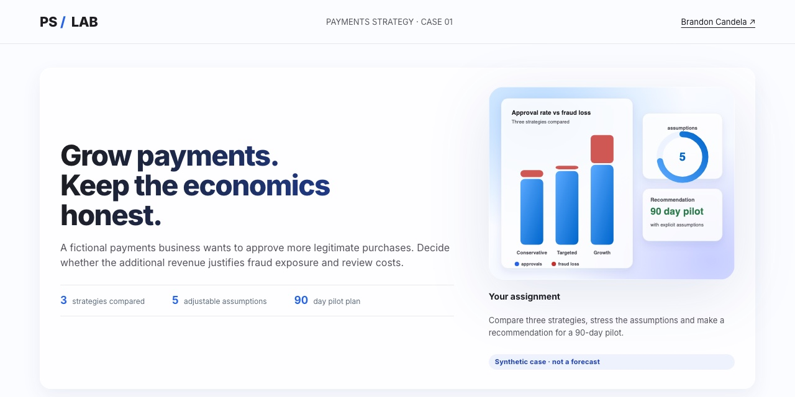

# Payments Strategy Lab

**[▶ Open the live demo](https://brandoncandela.github.io/payments-strategy-lab/)** · [Technical case study](https://brandoncandela.github.io/case-studies/payments-strategy-lab.html) · [Portfolio](https://brandoncandela.github.io/) · [LinkedIn](https://www.linkedin.com/in/brandon-candela/) · Built by Brandon Candela, CAMS

> **What this shows:** Payments unit economics, fraud-loss vs. approval-rate tradeoffs, review-team capacity planning and a decision memo, backed by a tested model.

**A consulting case about profitable growth, fraud exposure and operational capacity.** Built by [Brandon Candela](https://brandoncandela.github.io/).

A fictional payments company wants to approve more legitimate purchases. Compare three strategies, change business assumptions, inspect the economics and write a recommendation for a 90-day pilot.

## What this demonstrates
- Structured business problem solving and transparent unit economics
- Sensitivity analysis and the difference between a scenario and a prediction
- Operations planning: capacity constraints, overflow and staffing tradeoffs
- Executive communication: a downloadable decision memo and pilot plan
- Testable JavaScript financial model with an independently calculated reference case

This complements my SQL Financial Crime Lab by moving from transaction monitoring to an executive decision about growth, risk and resources.

## Try it
[Open the public demo](https://brandoncandela.github.io/payments-strategy-lab/), or run `python3 -m http.server 5191 --directory dist` and visit http://localhost:5191.

1. Compare monthly contribution and losses across three strategies.
2. Increase fraud incidence or change the review team.
3. Explore whether staffing up pays for itself.
4. Select a strategy, write your reasoning and download the memo.

## Review the work
- [Pure financial model](dist/model.js)
- [Methodology, formulas and limitations](dist/methodology.md)
- [Tests](tests/model.test.js)

Run tests with `node --test tests/model.test.js` (modern Node.js). No external packages required.

## Limits
The company, inputs and policy rates are made up for the exercise; they are not market benchmarks or a real client's numbers. Contribution leaves out corporate overhead, tax, capital, acquisition costs and long-term customer value. Payments the review team has no time for are declined. Notes stay in the page until you close it, so download the memo to keep them.

Built with AI coding tools.
